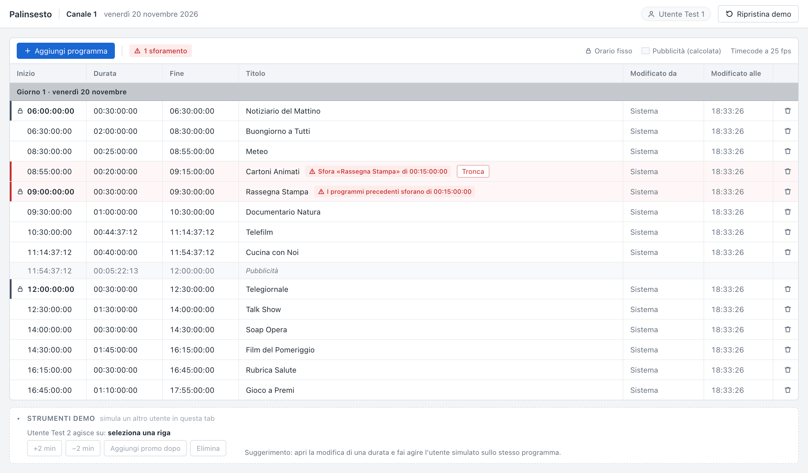

# Palinsesto TV

Schermata in **React + TypeScript** per preparare il palinsesto di un canale TV **in più persone contemporaneamente**: si vedono i programmi con orario di inizio e durata in **timecode a 25 fps**, si modificano le durate, si aggiungono ed eliminano programmi, e le modifiche degli altri arrivano in tempo reale.

**▶ Provala online: [chimerical-starship-36e06e.netlify.app](https://chimerical-starship-36e06e.netlify.app)**. Per vedere il lavoro a più mani apri due tab affiancate oppure usa il pannello "Strumenti demo" (vedi [sotto](#provare-il-lavoro-a-più-mani)).



> Ragionamenti, alternative valutate e decisioni sono documentati passo per passo in **[DOCUMENTAZIONE.md](DOCUMENTAZIONE.md)**.

---

## Demo
https://github.com/user-attachments/assets/cbb20d7d-d1a1-4453-b3b8-e495c8ca7bcb

## Le tre criticità

| Domanda | Risposta |
|---|---|
| **Cosa succede al resto del palinsesto quando un programma diventa più lungo o più corto?** | I programmi **flottanti** slittano a cascata, in avanti o indietro. Quelli **a orario fisso** (es. un telegiornale) non si spostano mai. Lo spazio libero prima di un orario fisso diventa **pubblicità**, calcolata e mostrata in modo esplicito. Se i programmi precedenti invadono un orario fisso, la modifica viene accettata e lo **sforamento viene segnalato**, con l'entità e un'azione rapida "Tronca". |
| **Cosa succede se qualcun altro modifica lo stesso programma?** | **Blocco ottimistico**: ogni programma ha una versione. Se salvi partendo da una versione superata, il server rifiuta la modifica e una finestra mostra il tuo valore e quello dell'altro, così scegli tu quale tenere. Nessuna modifica viene persa senza che nessuno se ne accorga. |
| **Cosa vede l'utente quando i dati cambiano mentre li sta guardando?** | La riga cambiata si **evidenzia** per qualche secondo, una **notifica** dice chi ha fatto cosa, e le colonne "Modificato da / alle" ne lasciano traccia. Se qualcuno cambia il programma che stai modificando, un **avviso** compare subito sotto il campo, senza toccare quello che stai scrivendo. Niente scroll automatici né righe che si spostano sotto il cursore. |

## Funzionalità

- Palinsesto su **più giorni**, raggruppato per giorno. Ogni programma può attraversare la mezzanotte.
- **Timecode `HH:MM:SS:FF` a 25 fps** con campo a maschera: si scrive da sinistra a destra, Invio salva, Esc annulla.
- **Programmi a orario fisso** e **flottanti**, pubblicità calcolata con avviso oltre i 12 minuti, riepilogo dei problemi.
- **Aggiunta** di un programma: flottante dopo la riga selezionata, oppure a orario fisso con giorno e ora.
- **Eliminazione** e **"Tronca"** con conferma, protette dallo stesso controllo di versione delle modifiche.
- **Multiutente simulato**: tra più tab del browser e tramite il pannello "Strumenti demo".

## Avvio

Requisiti: **Node.js 22** o superiore.

```bash
npm install
npm run dev        # avvia l'app in sviluppo (http://localhost:5173)
npm test           # esegue i test
npm run lint       # analisi statica
npm run build      # build di produzione nella cartella dist/
```

## Provare il lavoro a più mani

I dati sono simulati nel browser, senza backend. Per vedere la concorrenza ci sono due modi:

1. **Due tab affiancate** sullo stesso indirizzo. Ogni tab è un utente diverso ("Utente Test 1", "Utente Test 3"…) e le modifiche passano da una all'altra in tempo reale.
2. **Pannello "Strumenti demo"**, in fondo alla pagina: un utente simulato agisce sulla riga selezionata. Per vedere un conflitto con una sola tab:
   1. clicca sulla durata di un programma e cambiala, **senza premere Invio**;
   2. nel pannello premi **+2 min**: sotto il campo compare l'avviso che qualcun altro ha cambiato quel programma;
   3. premi **Invio**: si apre la finestra di conflitto.

"Ripristina demo", in alto a destra, riporta i dati allo stato iniziale.

> Il "server" vive nel `localStorage` del browser: il multiutente funziona tra le tab dello **stesso browser**, non tra computer diversi.

## Architettura

Architettura **MVVM**, con i *custom hook* di React nel ruolo di ViewModel. Le dipendenze puntano solo verso l'interno:

```text
ui/       componenti React: solo vista                      ← View
hooks/    use…ViewModel: stato della schermata e azioni     ← ViewModel
data/     ScheduleRepository (interfaccia)                  ← Repository
          └ FakeScheduleServer: backend simulato nel browser
domain/   TypeScript puro, senza React: timecode, calcolo   ← Model
          del palinsesto, regole dei comandi
```

- **`domain/`** contiene tutta la logica, come funzioni pure testabili senza browser:
  - `computeSchedule` ricava orari, pubblicità e sforamenti dalla lista dei programmi;
  - `commands` applica modifiche, aggiunte ed eliminazioni con il controllo di versione.
- **`data/`** espone l'interfaccia `ScheduleRepository`. L'implementazione attuale è simulata, ma un backend reale (REST + WebSocket) può sostituirla **senza toccare la UI**.
- Le dipendenze arrivano ai componenti tramite un **Context** React (dependency injection).
- Nessuna libreria di stato né di componenti: React, TypeScript in modalità `strict`, CSS Modules, Vite e Vitest.

## Scelte tecniche principali

- **Il tempo è un numero intero di frame** (1 secondo = 25 frame): niente arrotondamenti e calcoli fatti con somme di interi. La stringa `HH:MM:SS:FF` esiste solo quando si mostra o si legge un valore.
- **Stato derivato invece di stato duplicato**: si salvano solo le durate e gli orari dei programmi a orario fisso. Inizi dei flottanti, fine e pubblicità vengono **sempre ricalcolati**, quindi non possono mai essere incoerenti.
- **Errori come valori** (`Result`), non come eccezioni: un input sbagliato dell'utente è un caso previsto.
- **L'istante di ogni modifica lo assegna il server**, non il client, per non dipendere dagli orologi dei singoli utenti.

## Test

Oltre **100 test** con Vitest, concentrati dove sta la logica:

- conversioni e validazione del timecode;
- motore del palinsesto: cascata, pubblicità, sforamenti, programmi a cavallo della mezzanotte, raggruppamento per giorno;
- comandi e concorrenza: conflitti di versione, due client sullo stesso programma, inserimento delle ancore, eliminazione;
- server simulato: sincronizzazione tra due tab simulate, corsa tra un client lento e uno veloce;
- rilevamento delle modifiche fatte da altri e formattazione di date e orari.

## Struttura

```text
src/
  app/       dipendenze condivise (Context)
  domain/    timecode, palinsesto, comandi, modifiche remote (+ test)
  data/      repository, server simulato, utente simulato, dati demo (+ test)
  hooks/     ViewModel delle schermate e delle finestre
  ui/        componenti e stili (CSS Modules)
docs/        immagini per il README
```

## Limiti noti

È un esercizio, e alcune cose sono state lasciate fuori di proposito: backend reale, autenticazione, annulla/ripeti, riordino dei programmi, più canali, versione mobile. L'elenco completo, con il motivo di ogni scelta e le proposte di evoluzione, è nelle sezioni **"Cosa ho lasciato per strada"** e **"Come si può migliorare"** di [DOCUMENTAZIONE.md](DOCUMENTAZIONE.md).
